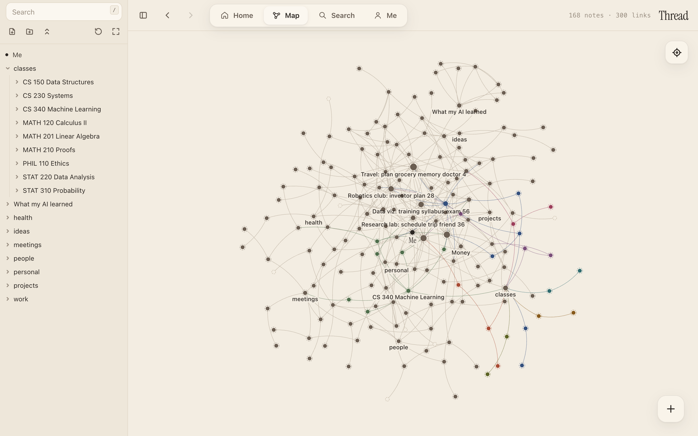
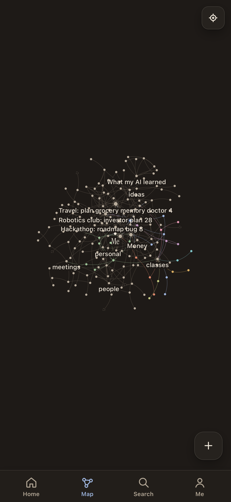
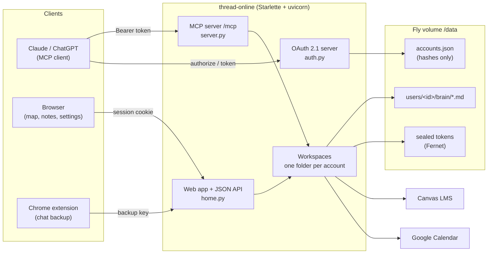

# Thread

A personal memory for students that any AI can read and write. Notes are plain Markdown files, shown as an
Obsidian-style map, and exposed to Claude and ChatGPT through an MCP server, alongside the student's Canvas
deadlines and Google Calendar.

> **Status:** personal project, not maintained as a product. The code works and is tested; there is no hosted
> service to sign up for.



## What it does

- **Memory over MCP.** 27 tools (`remember`, `search_memory`, `read_note`, `catch_up`, `log_chat`, `whats_due`,
  `read_syllabus`, `add_to_calendar`, ...) let an AI save and recall notes in the signed-in user's own folder.
  Each tool carries read-only/destructive annotations.
- **The map.** Every note is a dot, every `[[wikilink]]` a thread. A d3-force simulation matched to Obsidian's
  graph view, drawn on a single HTML canvas; it holds 60 fps while zooming and dragging at 3,000 notes under a 4×
  CPU throttle.
- **Canvas LMS.** Deadlines from the student's calendar feed link or an access token; syllabus text pulled from
  the syllabus page, wiki pages and PDFs; read-only tools for announcements, assignments, pages and modules.
- **Google Calendar.** Read upcoming events and add new ones the user asks for.
- **Fingerprint and voice.** Short, visible notes about how the user works and writes, ranked by recency, so the
  AI can answer the way they like.
- **Chat backup.** An optional Chrome extension keeps the last 10 days of ChatGPT/Claude chats, searchable from
  the AI.
- **Accounts.** Invite-only sign-up, OAuth 2.1 for AI apps, optional authenticator-app two-step sign-in.

| Map on a phone (dark) | |
|---|---|
|  | The phone layout is portrait-only: a bottom tab bar (Home · Map · Search · Me), pinch to zoom, drag a dot to pull its neighbours. |

## Architecture



- `src/thread/server.py`: MCP tools and the instructions handed to the AI; `main_online` builds the full app.
- `src/thread/auth.py`, `accounts.py`: sign-in, sessions, the OAuth provider, `thread-admin`.
- `src/thread/home.py`: web routes and JSON API for the home screen.
- `src/thread/brain.py`: reading and writing notes, links, the cached note index and the map graph.
- `src/thread/canvas*.py`, `gcal.py`: integrations. `sealed.py`: encryption at rest. `twofactor.py`: TOTP.
- `src/thread/web/`: the single-page front end (`app.js`, `style.css`, `index.html`, vendored d3).
- `extension/`: the Chrome extension.

## Tech stack

Python 3.12 · [MCP Python SDK](https://github.com/modelcontextprotocol/python-sdk) 2.2 · Starlette 1.7 · uvicorn ·
httpx · cryptography (Fernet) · segno (QR codes) · pypdf · Google API client · d3 7.9 (force simulation, zoom) ·
HTML Canvas 2D · pytest · Playwright (visual checks) · Docker · Fly.io · uv.

## Run it locally

Requires [uv](https://docs.astral.sh/uv/).

```bash
uv sync
uv run pytest -q                                    # the test suite
THREAD_BRAIN_DIR=/tmp/my-brain uv run thread-home   # single-user web app at http://127.0.0.1:8765
uv run thread                                       # MCP server over stdio (Claude Code, Claude Desktop)
```

`thread-home` and `thread` use `~/thread-brain` unless `THREAD_BRAIN_DIR` is set.

To try the multi-account online server on your laptop with a throwaway account:

```bash
scripts/preview-online.sh
```

Synthetic data for screenshots and load tests:

```bash
uv run python scale-lab/gen.py /tmp/synth 300
uv run python scale-lab/serve.py /tmp/synth 8800
```

## Deploy

The online server runs as one Fly.io machine with a 1 GB volume (about $2–3 a month at the time of writing).
See [docs/DEPLOY.md](docs/DEPLOY.md). It refuses to start without `THREAD_SECRET_KEY`; [.env.example](.env.example)
lists every setting.

## Security

- Passwords are scrypt hashes; sessions, OAuth tokens, invite codes and backup keys are stored only as SHA-256
  hashes.
- Canvas tokens, feed links, Google refresh tokens and TOTP secrets are encrypted at rest with Fernet, keyed by a
  server secret that never touches the volume.
- Refresh-token rotation with reuse detection: a replayed refresh token revokes the whole chain.
- Per-account lockout plus a per-IP limit keyed on `Fly-Client-IP`, not the spoofable `X-Forwarded-For`.
- Optional TOTP (RFC 6238, ±1 step, replay-protected) with scrypt-hashed recovery codes, and step-up
  re-authentication before sensitive actions.
- Strict CSP with per-response nonces, HSTS, CSRF checks on every form POST, an SSRF guard on outbound fetches,
  upload size caps.
- Stored text returned to the AI is fenced and labelled as data, to blunt prompt injection.

See [SECURITY.md](SECURITY.md) and [docs/SECURITY-threat-model.md](docs/SECURITY-threat-model.md).

## Tests

```bash
uv run pytest -q
```

About 280 tests cover the note store, the MCP tools, sign-in and OAuth flows, two-step sign-in, encryption,
Canvas and Calendar parsing (with fakes), the security fixes (one regression test each), and scale checks.

## Lessons learned

The hard problem wasn't storage or retrieval, it was capture. Everything Thread knows has to be written by
the AI calling `remember` or `log_chat`, and in practice the AI apps rarely did:

- Claude and ChatGPT ship their own built-in memory, and when the model decides to remember something it
  reaches for the first-party tool.
- Some clients load connector tools lazily, so Thread's tools and instructions often aren't in context when a
  chat starts, and "call `catch_up` first" never fires.
- Over two weeks of daily use, the server received no new notes from either test account.

A memory layer that depends on the model choosing to call it loses to the host app's own memory. Capture has to
happen without the model's cooperation (a browser extension, an export import, or owning the chat surface), and
on phones, where most student chats happen, the native apps allow none of those. That's why this stayed a
project.

## License

MIT, see [LICENSE](LICENSE). Third-party components are listed in [THIRD_PARTY_NOTICES.md](THIRD_PARTY_NOTICES.md).
